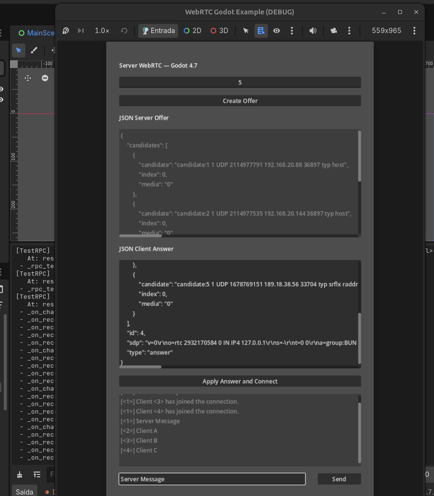
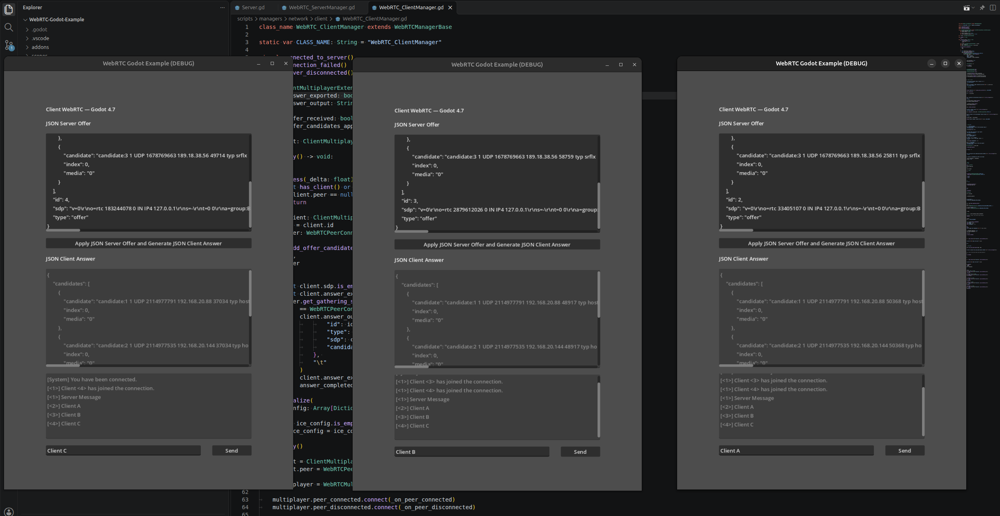

# WebRTC - Godot Example

A Godot demo of peer-to-peer multiplayer using WebRTC. It establishes a real WebRTC connection while keeping signaling manual: exchange SDP and ICE data as JSON by copy and paste. There is no signaling server.

## Screenshots

| Server | Multiple clients |
| --- | --- |
|  |  |

## Requirements

- Godot 4.7, the version configured by this project.
- The native WebRTC extension in `addons/webrtc_native/`, from the [WebRTC plugin - Godot 4.3+](https://godotengine.org/asset-library/asset/2103) on the Godot Asset Library.
- One game instance for the server and a separate instance for each client.

The extension binaries are included for Linux, Windows, macOS, Android, and iOS. Included binaries still need to be tested on the target OS and architecture. Although the extension declares Godot 4.3 as its minimum, this project is configured for Godot 4.7.

## Run and connect

1. Open the project in Godot 4.7 and run the main scene.
2. Select **I want to be a Server** in one instance. Select **I want to be a Client** in every other instance. Run each participant in a separate process or on a separate device.
3. On the server, keep the initial ID at `2` for the first client and press **Create Offer**. Wait for ICE gathering to finish; the offer JSON will appear in the server field.
4. Paste the complete offer JSON into a client's **JSON Server Offer** field and press **Apply JSON Server Offer and Generate JSON Client Answer**.
5. Copy the answer JSON from the client into **JSON Client Answer** on the server and press **Apply Answer and Connect**.
6. Once connected, use the chat in either instance to verify communication.

### Multiple clients

Each client needs its own connection and a unique ID starting at `2`. The server's **Create Offer** button increments the ID. Negotiate clients one at a time: copy each offer before creating the next, because the server UI displays one offer at a time; then apply the matching answer on the server. The JSON `id` associates each message with its peer connection.

## Signaling and ICE configuration

The server creates an SDP offer for a client ID and includes the gathered ICE candidates in its JSON. The client applies the offer and produces an SDP answer with its own candidates. The answer is returned to the server to complete negotiation. This example sends SDP and ICE together after gathering completes; it does not exchange candidates incrementally or provide an automatic signaling channel.

The STUN configuration uses public servers. `scripts/game/Server.gd` and `scripts/game/Client.gd` also contain fictional TURN addresses and credentials: replace them with a valid TURN service or remove those TURN configuration calls before testing. STUN may be enough on some networks, while restrictive NATs and firewalls may require TURN. Never ship private TURN credentials in a public repository or distributed client; use a backend to provide temporary credentials in a real game.

## License

The project code is licensed under MIT; see `LICENSE`. The WebRTC Native extension and its dependencies have their own licenses in `addons/webrtc_native/`.
